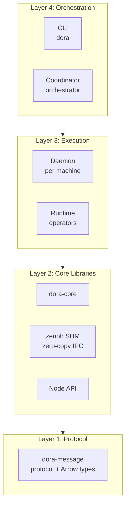

# Dora Architecture

Comprehensive architecture reference for Dora (AI-Dora, Agentic Dataflow-Oriented Robotic Architecture) — a 100% Rust framework for real-time robotics and AI applications.

## Overview and Design Philosophy

Dora is built on four core principles:

1. **Dataflow-oriented**: Applications are directed graphs of nodes connected by typed data channels. Nodes declare inputs and outputs; the framework handles routing, scheduling, and lifecycle.
2. **Zero-copy performance**: Messages of 4 KiB or more are published through Zenoh shared memory, so subscribers on the same machine read them without a copy, achieving 10-17x lower latency than ROS2.
3. **Multi-language**: First-class support for Rust, Python (PyO3), C, and C++ nodes — all sharing the same Apache Arrow data format.
4. **Four-layer stack**: Message protocol, core libraries, daemon/runtime execution, and CLI/coordinator orchestration.

### Architecture Stack



## Workspace Structure

**Rust edition 2024; MSRV and default workspace package metadata are
tracked in `[workspace.package]` in the root `Cargo.toml`.** Most
crates inherit the workspace version via `version.workspace = true`;
a handful (e.g. `apis/rust/operator/types`, the
`examples/error-propagation/*` samples) pin their own version
independently.

### Binaries (7)

| Path | Crate | Role |
|------|-------|------|
| `binaries/cli` | dora-cli | CLI binary (`dora` command) — build, run, stop dataflows |
| `binaries/coordinator` | dora-coordinator | Orchestrates distributed multi-daemon deployments; WebSocket server |
| `binaries/daemon` | dora-daemon | Spawns nodes, serves their TCP connections, and forwards daemon-path outputs to other daemons, per machine |
| `binaries/runtime-api` | dora-runtime-api | Language-neutral operator runtime SDK (event loop + `OperatorRunner` backend trait) |
| `binaries/runtime-shared-lib` | dora-runtime-shared-lib | Shared-library operator backend (C/C++/Rust via dlopen); shipped in the `dora` CLI |
| `binaries/runtime-python` | dora-runtime-python | Python operator backend (PyO3); shipped in the Python wheel |
| `binaries/ros2-bridge-node` | dora-ros2-bridge-node | ROS2 integration node |
| `binaries/record-node` | dora-record-node | Records dataflow messages to `.drec` format |
| `binaries/replay-node` | dora-replay-node | Replays recorded messages from `.drec` files |

### Core Libraries (5)

| Path | Crate | Role |
|------|-------|------|
| `libraries/message` | dora-message | All inter-component message types, protocol definitions, Arrow metadata |
| `libraries/core` | dora-core | Dataflow descriptor parsing, build utilities, Zenoh config |
| `libraries/recording` | dora-recording | Recording format (.drec): binary header + entries + footer |
| `libraries/arrow-convert` | dora-arrow-convert | Arrow type conversions (numeric, datetime) |
| `libraries/coordinator-store` | dora-coordinator-store | State persistence for coordinator (in-memory or redb backend) |

### Extension Libraries (5)

| Path | Crate | Role |
|------|-------|------|
| `libraries/extensions/telemetry/tracing` | dora-tracing | OpenTelemetry distributed tracing (OTLP exporter) |
| `libraries/extensions/telemetry/metrics` | dora-metrics | System metrics collection (CPU, memory, disk) |
| `libraries/extensions/download` | dora-download | HTTP file download utility for operator/node binaries |
| `libraries/extensions/ros2-bridge` | dora-ros2-bridge | ROS2 integration: topic pub/sub, services, actions |
| `libraries/log-utils` | dora-log-utils | Log parsing, merging, filtering, formatting |

### API Crates (9)

| Path | Crate | Language |
|------|-------|----------|
| `apis/rust/node` | dora-node-api | Rust |
| `apis/rust/operator` | dora-operator-api | Rust |
| `apis/rust/operator/macros` | dora-operator-api-macros | Rust (proc-macro) |
| `apis/rust/operator/types` | dora-operator-api-types | Rust (FFI-safe types) |
| `apis/python/node` | dora-node-api-python | Python (PyO3) -- builds the `dora` module |
| `apis/python/operator` | dora-operator-api-python | Python (PyO3) -- compiled into dora-node-api-python |
| `apis/c/node` | dora-node-api-c | C |
| `apis/c/operator` | dora-operator-api-c | C/C++ |

## Component Architecture

### CLI

The `dora` command provides three command groups:

**Lifecycle** (run, up, down, build, start, stop, restart):
- `dora run` executes a dataflow locally without coordinator/daemon (single-machine shortcut)
- `dora up` / `dora down` manage coordinator + daemon infrastructure
- `dora start` / `dora stop` control dataflows on a running coordinator

**Monitoring** (list, logs, inspect, topic, node, record, replay, trace):
- Real-time inspection with `dora inspect top`
- Topic subscription and data inspection
- Recording and replay via `.drec` files

**Setup** (status, new, graph, system, completion, self):
- Project scaffolding, dataflow visualization, self-update

### Coordinator

The coordinator is an Axum-based WebSocket server that orchestrates distributed deployments.

```
                          ┌──────────────────┐
                          │   Coordinator     │
            WS /api/control  │  ┌────────────┐  │  WS /api/daemon
   CLI ◄──────────────────►  │  │   State    │  │ ◄──────────────────► Daemon(s)
                          │  │   Store    │  │
                          │  └────────────┘  │
                          │  /api/artifacts  │
                          │  /health         │
                          └──────────────────┘
```

**WebSocket routes:**
- `/api/control` — CLI control plane (build, start, stop, list, logs, topic subscribe)
- `/api/daemon` — Daemon registration and event stream
- `/api/artifacts/{build_id}/{node_id}` — Binary artifact downloads
- `/health` — Health check endpoint

**State management:** In-memory by default, optional persistent storage via `redb` backend.

### Daemon

The daemon runs one per machine and manages the lifecycle of all nodes on that machine.

```
┌──────────────────────────────────────────────────────┐
│                     Daemon                           │
│                                                      │
│  ┌──────────┐  ┌───────────┐  ┌──────────────────┐  │
│  │ Event    │  │ Spawner   │  │ Node Comm        │  │
│  │ Loop     │──│ (nodes)   │  │ ┌──────────────┐ │  │
│  │          │  └───────────┘  │ │ TCP listener │ │  │
│  │ Sources: │  ┌───────────┐  │ │ per node     │ │  │
│  │ • Coord  │  │ Fault     │  │ │ (127.0.0.1)  │ │  │
│  │ • Nodes  │──│ Tolerance │  │ └──────────────┘ │  │
│  │ • Zenoh  │  └───────────┘  └──────────────────┘  │
│  │ • Timers │                                        │
│  └──────────┘                                        │
│                                                      │
│  ┌──────────────────────────────────────────────┐    │
│  │ Running Dataflows                            │    │
│  │  ├─ Node A (process) ◄──► TCP                │    │
│  │  ├─ Node B (process) ◄──► TCP                │    │
│  │  └─ Runtime (operators) ◄──► TCP             │    │
│  └──────────────────────────────────────────────┘    │
└──────────────────────────────────────────────────────┘
```

**Event loop** (`Daemon::run_inner()`): Async Tokio event loop merging:
- Coordinator commands (WebSocket)
- Node events (TCP)
- Inter-daemon events (Zenoh)
- Heartbeat (5s interval), metrics collection (2s), health checks (5s default)

**Node spawning:**
1. Create working directory for the node
2. Bind a per-node TCP listener on `127.0.0.1` (ephemeral port)
3. Serialize `NodeConfig` to environment variable
4. Spawn process with sanitized environment (blocks `LD_PRELOAD`, `DYLD_INSERT_LIBRARIES`, etc.; descriptor `env:` entries cannot override the daemon's own control-plane variables — `DORA_NODE_CONFIG`, `DORA_RUNTIME_CONFIG`, `DORA_ZENOH_*`)
5. Monitor via `ProcessHandle`

### Runtime

The runtime executes in-process operators (Python, shared library, WASM) in a dedicated process.

```
┌──────────────────────────────┐
│          Runtime             │
│                              │
│  ┌────────────────────────┐  │
│  │ Operator Runner        │  │
│  │ (separate thread)      │  │
│  │                        │  │
│  │ SharedLibrary → dlopen │  │
│  │ Python → PyO3          │  │
│  │ Wasm → (planned)       │  │
│  └──────────┬─────────────┘  │
│             │ flume(2)       │
│  ┌──────────▼─────────────┐  │
│  │ Event Merge Loop       │  │
│  │ ├─ OperatorEvent       │  │
│  │ └─ DaemonEvent         │  │
│  └────────────────────────┘  │
└──────────────────────────────┘
```

- Single-threaded Tokio runtime
- Operator runs in a separate thread, communicates via `flume::bounded(2)` channel
- Input queue size per data ID configurable (default: 10)

### Nodes

Nodes are standalone processes that communicate with the daemon.

**Lifecycle:**
1. Node starts, reads `NodeConfig` from environment
2. Registers with daemon via `DaemonRequest::Register`
3. Subscribes to events via `DaemonRequest::Subscribe`
4. Processes events in a loop (`NextEvent` → handle → send outputs)
5. Sends each output either as `SendMessage` (daemon path) or by publishing on Zenoh and reporting `OutputSent` (direct path)
6. Signals completion via `OutputsDone`

## Communication Protocols

### CLI to Coordinator (WebSocket)

| Property | Value |
|----------|-------|
| Transport | WebSocket over TCP |
| Default port | 6013 |
| Auth | Bearer token in `Authorization` header |
| Control messages | JSON text frames (request/response/event) |
| Topic data | Binary frames: `[16-byte UUID][postcard payload]` |
| Rate limit | 20 connections per IP per 60s |
| Max connections | 256 |

**JSON-RPC-like message format:**

```json
// Request (client → server)
{"id": "uuid", "method": "control", "params": {...}}

// Response (server → client)
{"id": "uuid", "result": {...}}
// or
{"id": "uuid", "error": "message"}

// Event (fire-and-forget, either direction)
{"event": "log", "payload": {...}}
```

**Key control methods:** `Build`, `Start`, `Stop`, `List`, `Logs`, `TopicSubscribe`, `TopicUnsubscribe`, `Reload`, `Restart`, `Destroy`.

### Coordinator to Daemon (WebSocket)

| Property | Value |
|----------|-------|
| Transport | WebSocket (daemon connects to coordinator) |
| Route | `/api/daemon` |
| Retry | Exponential backoff 1s → 30s, max 50 attempts |
| Registration | `DaemonRegisterRequest` with version, machine_id, labels |

**Daemon events (daemon → coordinator):** `BuildResult`, `SpawnResult`, `AllNodesReady`, `AllNodesFinished`, `Heartbeat`, `StatusReport`, `Log`, `NodeMetrics`, `Exit`.

**Coordinator commands (coordinator → daemon):** `Build`, `Spawn`, `AllNodesReady`, `StopDataflow`, `ReloadDataflow`, `Logs`, `Destroy`, `Heartbeat`.

### Node to Node (Zenoh Data Plane)

Nodes can publish an output straight to the nodes that consume it over Zenoh,
so the payload does not pass through the daemon (the *direct path*):

- Each node opens a Zenoh session with a shared-memory (SHM) pool: 8 MiB by default, set per node with `shared_memory_pool_size` in the dataflow YAML or globally with `DORA_NODE_SHM_POOL_SIZE`
- Payloads of 4 KiB or more (`ZERO_COPY_THRESHOLD`, overridable with `DORA_ZERO_COPY_THRESHOLD` up to 32 KiB) are written into a Zenoh SHM buffer; smaller payloads use a heap-buffered `put`
- Subscribers on the same machine map the SHM buffer as an Arrow buffer without copying it; subscribers on other machines receive the bytes over the network
- A payload of 4 KiB or more that cannot get an SHM buffer (the pool is momentarily full, or no SHM provider could be created at startup) is sent on the daemon path instead of Zenoh, because a fragmented Zenoh publish could be dropped silently (dora-rs/dora#2366). The node does not wait for the pool to drain
- After each direct publish the node sends a small `OutputSent` request to the daemon, which uses it for input deadlines and circuit-breaker recovery. The payload itself is not copied through the daemon

**Direct path or daemon path.** Before the dataflow starts, each node publishes startup markers on its outputs and its required consumers acknowledge them (the startup handshake, bounded by `ZENOH_STARTUP_GRACE`, 500 ms). An output uses the direct path only once its routes are proven this way, and the choice is then fixed for the node's lifetime. Otherwise the output uses the daemon path (node → daemon → receivers over TCP, payload carried in `DataMessage::Vec`, limited to `MAX_MESSAGE_BYTES`). The daemon pins an output to the daemon path when it spawns the dataflow (`binaries/daemon/src/output_routing.rs`) if:

- a consumer declares `queue_policy: backpressure`
- a consumer runs under another daemon and is dynamic, declares `input_timeout`, or the producer has no endpoint that consumer's machine can dial

The node also keeps an output on the daemon path when:

- the startup handshake does not complete within its window
- the node has no Zenoh session (interactive or testing mode)

### Daemon to Node (Control Plane)

Nodes talk to their daemon over TCP; it is the only daemon-to-node transport. The daemon binds one listener per node on `127.0.0.1:0` (ephemeral port) and gives the node its address in `NodeConfig` (`DaemonCommunication::Tcp { socket_addr }`).

- Each node opens several connections to its listener (control channel, event stream, event-close channel). Each starts with `DaemonRequest::Register`
- `TCP_NODELAY` is enabled
- Frame format: `[8-byte u64 LE length][postcard payload]`
- Max message: 64 MiB (`MAX_MESSAGE_BYTES`). A frame body that stalls for more than 30 s (`TCP_READ_TIMEOUT`) closes the connection; idle connections between requests are not timed out
- A dynamic node (started outside the daemon) first asks the daemon's dynamic-node listener for its `NodeConfig`: port 53291 by default (`DORA_DAEMON_LOCAL_LISTEN_PORT_DEFAULT`), overridable with `DORA_DAEMON_LOCAL_LISTEN_PORT`. That listener answers only `NodeConfig` requests, with a JSON `DynamicNodeConfigReply`; the node's `NodeConfig` includes its `daemon_communication`, and the connection described above follows

**Node → Daemon requests:** `Register`, `Subscribe`, `SendMessage`, `OutputSent`, `CloseOutputs`, `OutputsDone`, `NextEvent`, `EventStreamDropped`, `NodeConfig`, `ExtensionStore`, `ExtensionLoad`, `ExtensionDrop`, `ExtensionRequest`.

**Daemon → Node replies:** `Result`, `NextEvents`, `NodeConfig`, `ExtensionValue`, `ExtensionReply`, `Empty`.

**Node events:** `Stop`, `Reload`, `Input`, `InputClosed`, `InputRecovered`, `NodeRestarted`, `AllInputsClosed`, `ParamUpdate`, `ParamDeleted`, `NodeFailed`, `ExtensionDropped`.

### Daemon to Daemon (Zenoh)

| Property | Value |
|----------|-------|
| Transport | Zenoh pub-sub |
| Router port | 7447 |
| Peer port | 5456 |
| Routing | linkstate |
| Serialization | postcard |

**Topic pattern** (frames published by daemons):
```
dora/{network_id}/{dataflow_id}/control/{node_id}/{output_id}
```

Default `network_id` is `"default"`. Raw node outputs published directly over Zenoh use the `output` topic instead (see Zenoh Topic Naming).

**InterDaemonEvent:**
- `Output { dataflow_id, node_id, output_id, metadata, data }` — data message
- `OutputClosed { dataflow_id, node_id, output_id }` — stream end

## Message Types and Wire Formats

### Timestamped Wrapper

All inter-component messages are wrapped in a timestamp:

```rust
pub struct Timestamped<T> {
    pub inner: T,
    pub timestamp: uhlc::Timestamp,  // hybrid logical clock
}
```

### DataMessage

Payload of a message sent over the daemon (TCP) path. Outputs published directly over Zenoh do not use it: the payload travels as raw Zenoh bytes with the metadata as an attachment (see Node to Node).

```rust
pub enum DataMessage {
    Vec(AVec<u8, ConstAlign<128>>),    // inline, 128-byte aligned
}
```

### LogMessage

```rust
pub struct LogMessage {
    pub build_id: Option<BuildId>,
    pub dataflow_id: Option<DataflowId>,
    pub node_id: Option<NodeId>,
    pub daemon_id: Option<DaemonId>,
    pub level: LogLevelOrStdout,       // Stdout | LogLevel(Error/Warn/Info/Debug/Trace)
    pub target: Option<String>,
    pub module_path: Option<String>,
    pub file: Option<String>,
    pub line: Option<u32>,
    pub message: String,
    pub timestamp: DateTime<Utc>,
    pub fields: Option<BTreeMap<String, String>>,
}
```

### NodeError

```rust
pub struct NodeError {
    pub timestamp: uhlc::Timestamp,
    pub cause: NodeErrorCause,         // GraceDuration | Cascading | FailedToSpawn | Other
    pub exit_status: NodeExitStatus,   // Success | IoError | ExitCode | Signal | Unknown
}
```

## Data Format and Metadata

### Apache Arrow

All data payloads use Apache Arrow columnar format with 128-byte alignment. The payload is a self-describing Arrow IPC stream, so the message carries no separate type descriptor — the `ArrowTypeInfo` sidecar that 0.x sent alongside every message was dropped in #2366.

The framing is announced through a metadata parameter rather than a struct field:

```rust
pub const FRAMING: &str = "_framing";
pub const FRAMING_ARROW_IPC: &str = "arrow-ipc";
pub const SCHEMA_HASH: &str = "_schema_hash";   // internal; set by the schema-once path
```

### Metadata

Every message carries structured metadata:

```rust
pub struct Metadata {
    metadata_version: u16,                // Metadata::CURRENT_VERSION
    timestamp: uhlc::Timestamp,
    pub parameters: MetadataParameters,   // BTreeMap<String, Parameter>
}
```

`metadata_version` is bumped whenever the wire format changes shape: 0 to 1 when the `ArrowTypeInfo` sidecar was dropped, and 1 to 2 when the binary encoding moved from bincode to postcard. A receiver compares it against `Metadata::CURRENT_VERSION` to report an incompatible peer clearly instead of failing with a positional-deserialization error.

### Parameter Types

```rust
pub enum Parameter {
    Bool(bool),
    Integer(i64),
    String(String),
    ListInt(Vec<i64>),
    Float(f64),
    ListFloat(Vec<f64>),
    ListString(Vec<String>),
    Timestamp(DateTime<Utc>),
}
```

### Well-Known Metadata Keys

| Key | Purpose |
|-----|---------|
| `request_id` | Service request/reply correlation |
| `goal_id` | Action goal identifier |
| `goal_status` | Action completion: `succeeded`, `aborted`, `canceled` |
| `session_id` | Streaming session identifier |
| `segment_id` | Streaming segment within a session |
| `seq` | Streaming chunk sequence number |
| `fin` | Last chunk of a streaming segment |
| `flush` | Discard older queued messages on input |

## Zero-Copy Shared Memory

Zero-copy transfer between co-located nodes uses Zenoh shared memory. Dora has no shared-memory channel of its own between daemon and node: that connection is TCP only.

### How it works

1. At startup each node creates a Zenoh SHM provider (default pool 8 MiB)
2. For an output of at least `ZERO_COPY_THRESHOLD`, the node allocates a buffer from the provider and writes the Arrow IPC payload into it. The allocation does not block: it reclaims freed buffers, and if the pool is still full the payload takes the daemon path instead
3. The node publishes the buffer on Zenoh with the metadata as an attachment
4. A subscriber on the same machine receives a reference to the same SHM mapping. The receiving node wraps it in an Arrow `Buffer` that owns the Zenoh buffer, so the mapping stays valid for as long as that Arrow buffer is alive and the payload is not copied

There is no separate release message: lifetime follows the Arrow `Buffer` that holds the Zenoh buffer.

### Thresholds and Limits

| Parameter | Value |
|-----------|-------|
| `ZERO_COPY_THRESHOLD` | 4096 bytes (override with `DORA_ZERO_COPY_THRESHOLD`, capped at 32 KiB) |
| Node SHM pool size | 8 MiB (`shared_memory_pool_size` or `DORA_NODE_SHM_POOL_SIZE`) |
| `MAX_MESSAGE_BYTES` | 64 MiB, daemon (TCP) path only; the direct path is bounded by the node's SHM pool instead, and a payload that does not fit takes the daemon path |

## Dataflow Specification

### YAML Format

```yaml
nodes:
  # Standard node (executable)
  - id: my-node
    build: cargo build --release
    path: target/release/my-node
    inputs:
      tick: dora/timer/millis/100
      data: other-node/output
    outputs:
      - result
    restart_policy: on-failure
    max_restarts: 3
    restart_delay: 1.0
    env:
      DEBUG: true

  # Single operator (Python)
  - id: processor
    operator:
      python: process.py
      inputs:
        image: camera/frame
      outputs:
        - detection

  # Operator list form (one operator per runtime node)
  - id: pipeline
    operators:
      - id: stage1
        shared-library: target/release/stage1
        inputs:
          data: source/output
        outputs:
          - intermediate

  # ROS2 bridge
  - id: ros-input
    ros2:
      topic: /robot/state
      message_type: sensor_msgs/JointState
      direction: subscribe
      qos:
        reliable: true
    outputs:
      - joints
```

### Descriptor Structs

```rust
pub struct Descriptor {
    pub nodes: Vec<Node>,
    pub communication: CommunicationConfig,
    pub deploy: Option<Deploy>,
    pub debug: Debug,
    pub health_check_interval: Option<f64>,  // default 5.0s
}
```

**Node types** (mutually exclusive fields):
- `path` — standard executable/script
- `operator` — single in-process operator
- `operators` — multiple in-process operators
- `custom` — legacy configuration
- `ros2` — declarative ROS2 bridge

### Timer Nodes

Built-in timer nodes generate periodic ticks:
- `dora/timer/millis/<N>` — every N milliseconds
- `dora/timer/secs/<N>` — every N seconds

### Operator Sources

```rust
pub enum OperatorSource {
    SharedLibrary(String),   // .so/.dll path
    Python(PythonSource),    // Python module
    Wasm(String),            // WebAssembly (planned)
}
```

### Deploy Configuration

```rust
pub struct Deploy {
    pub machine: Option<String>,
    pub working_dir: Option<PathBuf>,
    pub labels: BTreeMap<String, String>,
    pub distribute: DistributeStrategy,  // Local | Scp | Http
}
```

## Fault Tolerance

### Restart Policies

```rust
pub enum RestartPolicy {
    Never,       // default
    OnFailure,   // restart on non-zero exit
    Always,      // restart unless user-stopped or inputs closed
}
```

**Configuration fields per node:**
- `max_restarts` — 0 = unlimited
- `restart_delay` — initial backoff in seconds (doubles each attempt)
- `max_restart_delay` — caps exponential backoff
- `restart_window` — reset counter after N seconds (enables "N restarts per M seconds")
- `health_check_timeout` — kill node if no activity within this duration, measured only after the node connects (post-connection liveness)
- `startup_timeout` — kill node if it fails to connect/subscribe within this duration after process spawn (startup deadline)

### Health Monitoring

- **Heartbeat interval:** 5 seconds (daemon → coordinator)
- **Health check interval:** 5 seconds (configurable per dataflow)
- **Metrics collection:** 2-second interval (CPU, memory, disk, pending messages)

### Circuit Breaker

Per-input timeout detection with automatic recovery:

1. Input configured with `input_timeout: <seconds>`
2. If no data arrives within timeout → `InputClosed` event sent to node
3. Node marks input as degraded, can use cached last-known value
4. When upstream recovers → `InputRecovered` event, circuit breaker re-opens
5. Node status transitions: `Running` → `Degraded` → `Running`

### Cascading Error Tracking

```rust
pub struct CascadingErrorCauses {
    pub caused_by: BTreeMap<NodeId, NodeId>,
}
```

Tracks which node failure caused downstream failures, enabling root-cause analysis.

### Fault Tolerance Metrics

```rust
pub struct FaultToleranceSnapshot {
    pub restarts: u64,
    pub health_check_kills: u64,
    pub input_timeouts: u64,
    pub circuit_breaker_recoveries: u64,
}
```

Reported per daemon via heartbeat events. Visible via `dora inspect top`.

## Distributed Deployment

### Multi-Daemon Architecture

```
  ┌──────────┐       Zenoh        ┌──────────┐
  │ Daemon A │◄──────────────────►│ Daemon B │
  │ Machine 1│    pub/sub         │ Machine 2│
  │          │                    │          │
  │ Node 1   │                    │ Node 3   │
  │ Node 2   │                    │ Node 4   │
  └────┬─────┘                    └────┬─────┘
       │ WS                            │ WS
       └──────────┐  ┌────────────────┘
                  ▼  ▼
             ┌──────────┐
             │Coordinator│
             │  :6013    │
             └──────────┘
```

### Zenoh Topic Naming

```
dora/{network_id}/{dataflow_id}/output/{node_id}/{output_id}
```

- `network_id` isolates separate Dora clusters (default: `"default"`)
- Zenoh router port: 7447, peer port: 5456
- Routing mode: `linkstate`

### Build Distribution

Three strategies via `DistributeStrategy`:
- **Local** — each daemon builds from source (default)
- **Scp** — CLI pushes built binaries via SSH/SCP
- **Http** — daemons pull from coordinator's `/api/artifacts` endpoint

### Machine Labels

Nodes can target specific machines via labels:

```yaml
deploy:
  labels:
    gpu: "true"
    arch: "arm64"
```

## Recording and Replay

### .drec Binary Format

```
[HEADER]
├─ MAGIC: 8 bytes ("DORAREC")
├─ version: u16 LE (currently 1)
├─ start_nanos: u64 LE (Unix epoch nanoseconds)
├─ dataflow_id: 16 bytes (UUID)
├─ yaml_len: u32 LE
└─ descriptor_yaml: [u8; yaml_len]

[ENTRIES] (repeated)
├─ record_len: u32 LE
├─ node_id_len: u16 LE
├─ node_id: [u8; node_id_len]
├─ output_id_len: u16 LE
├─ output_id: [u8; output_id_len]
├─ timestamp_offset_nanos: u64 LE
├─ event_bytes_len: u32 LE
└─ event_bytes: [u8; event_bytes_len]    (postcard InterDaemonEvent)

[FOOTER] (optional, written on clean finish)
├─ FOOTER_MAGIC: 8 bytes ("DORAEND")
├─ total_messages: u64 LE
└─ total_bytes: u64 LE
```

### Writer/Reader API

```rust
pub struct RecordingWriter<W: Write> { /* ... */ }
impl<W: Write> RecordingWriter<W> {
    pub fn new(inner: W, header: &RecordingHeader) -> Result<Self>;
    pub fn write_entry(&mut self, entry: &RecordEntry) -> Result<()>;
    pub fn finish(self) -> Result<RecordingFooter>;
}

pub struct RecordingReader<R: Read> { /* ... */ }
impl<R: Read> RecordingReader<R> {
    pub fn open(inner: R) -> Result<Self>;
    pub fn header(&self) -> &RecordingHeader;
    pub fn next_entry(&mut self) -> Result<Option<RecordEntry>>;
}
```

## Extensions

### Telemetry

**Distributed Tracing** (`dora-tracing`):
- OpenTelemetry with OTLP exporter (compatible with Jaeger, Zipkin, Tempo)
- Context propagation across nodes
- Setup: `TracingBuilder::new(name)`, configured with its `with_*` methods, then `.build()`

**Metrics** (`dora-metrics`):
- System metrics via `sysinfo` (CPU, memory, disk)
- OpenTelemetry meter with OTLP exporter
- Async process observer: `run_metrics_monitor(meter_id)`

### ROS2 Bridge

Declarative YAML-based ROS2 integration supporting:

**Topics** — subscribe (ROS2 → Dora) or publish (Dora → ROS2):
```yaml
ros2:
  topic: /camera/image
  message_type: sensor_msgs/Image
  direction: subscribe
```

**Services** — client or server role:
```yaml
ros2:
  service: /add_two_ints
  service_type: example_interfaces/AddTwoInts
  role: client
```

**Actions** — goal/feedback/result lifecycle:
```yaml
ros2:
  action: /fibonacci
  action_type: example_interfaces/Fibonacci
  role: client
```

**QoS configuration:**
```yaml
qos:
  reliable: true
  durability: transient_local
  keep_last: 10
```

### Download

File download utility for fetching operator/node binaries from HTTP URLs. Sanitizes filenames, sets executable permissions on Unix.

## Key Constants and Defaults

| Constant | Value | Location |
|----------|-------|----------|
| `DORA_COORDINATOR_PORT_WS_DEFAULT` | 6013 | Coordinator WebSocket port |
| `DORA_DAEMON_LOCAL_LISTEN_PORT_DEFAULT` | 53291 | Dynamic-node listener port (`NodeConfig` lookups only) |
| `ZERO_COPY_THRESHOLD` | 4096 bytes | Zenoh SHM publish threshold |
| `MAX_MESSAGE_BYTES` | 64 MiB | Max daemon↔node TCP/postcard message |
| `MAX_CONTROL_MESSAGE_BYTES` | 1 MiB | Max control plane JSON message |
| `TCP_READ_TIMEOUT` | 30 seconds | Socket read timeout |
| `MAX_WS_CONNECTIONS` | 256 | Concurrent WebSocket limit |
| `MAX_CONNECTIONS_PER_IP` | 20 / 60s | Rate limiting |
| `MAX_TOPICS_PER_SUBSCRIBE` | 64 | Topic batch limit |
| `MAX_SUBSCRIPTIONS_PER_CONNECTION` | 16 | Per-connection limit |
| `MAX_BINARY_PAYLOAD_BYTES` | 64 MiB | Topic data frame limit |
| `WATCHDOG_INTERVAL` | 5 seconds | Heartbeat to coordinator |
| `METRICS_INTERVAL` | 2 seconds | Metrics collection |
| `HEALTH_CHECK_INTERVAL` | 5 seconds | Default node health check |
| `MAX_BUFFERED_LOG_MESSAGES` | 10,000 | Log buffer capacity |
| `MAX_PENDING_REPLIES` | 256 | Pending coordinator replies |
| `MAX_ERROR_BYTES` | 4096 | Max error message size |
| Default input queue size | 10 | Per-input message buffer |

## Identifiers and Data Structures

### ID Types

| Type | Underlying | Validation |
|------|-----------|------------|
| `DataflowId` | `uuid::Uuid` | Assigned on dataflow start |
| `SessionId` | `uuid::Uuid` (v7) | Per CLI session |
| `BuildId` | `uuid::Uuid` (v7) | Per build operation |
| `DaemonId` | `{ machine_id: Option<String>, uuid: Uuid (v7) }` | Created fresh on each start via `DaemonId::new(machine_id)` |
| `NodeId` | `String` | Validated: `[a-zA-Z0-9_.-]`, non-empty, no leading `.`, not the reserved id `dora` |
| `DataId` | `String` | Same validation as `NodeId` |
| `OperatorId` | `String` | No validation |

### Authentication

```rust
pub struct AuthToken(String);  // 64 hex chars (32 bytes)
```

- Generated via cryptographically random bytes
- Stored at `<working_dir>/.dora-token`
- Constant-time comparison to prevent timing attacks
- Applied to all WebSocket routes

### Node Status

```rust
pub enum NodeStatus {
    Running,     // healthy
    Restarting,  // restart in progress
    Degraded,    // circuit breaker open (input timeout)
    Failed,      // terminal failure
}
```

### Serialization Summary

| Channel | Format | Notes |
|---------|--------|-------|
| CLI ↔ Coordinator | JSON text frames | Preserves u128 for HLC timestamps |
| Coordinator ↔ Daemon | JSON text frames | Direct string serialization |
| Daemon ↔ Node (TCP) | postcard over length-prefixed frames | 8-byte LE length prefix |
| Node ↔ Node (Zenoh) | Arrow IPC payload bytes (small outputs send the schema separately) + metadata attachment | Direct path; see Node to Node |
| Daemon ↔ Daemon | postcard over Zenoh | Apache Arrow data format |
| Recording | postcard entries in .drec | Custom binary container |
