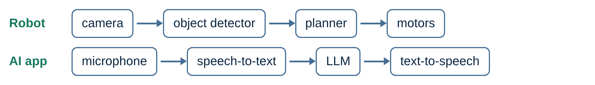
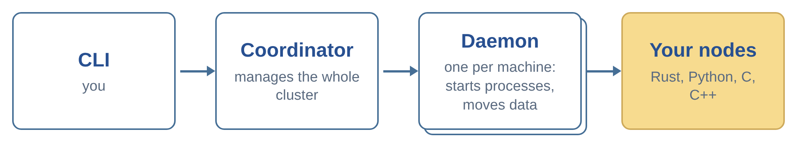
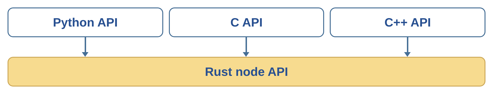
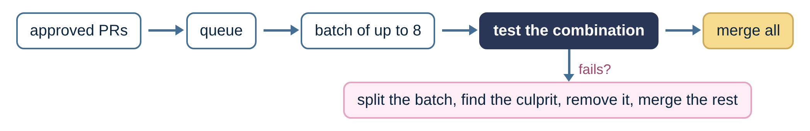
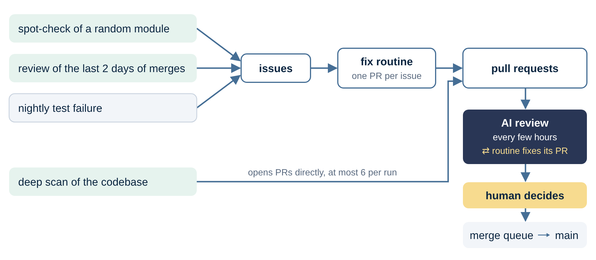
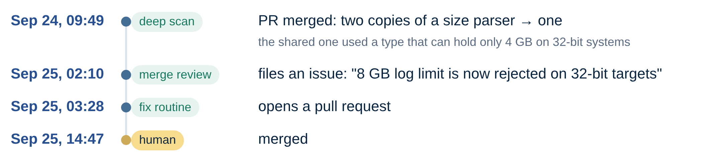
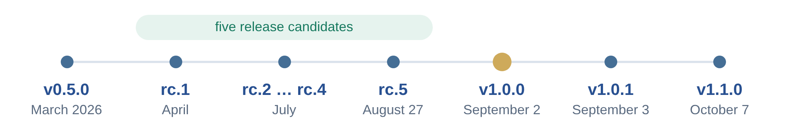

# Maintaining dora with agentic engineering

Dora is a framework for robotics and AI applications. Other people use it to build their own applications, so the quality of its codebase is very important to us. A bug in dora affects every application that uses it, and an API change can break user code. This post explains how we keep the code quality high now that most of the code is written by AI agents.

## Why we switched to agent-written code

Until February 2026, we wrote dora's code by hand. Then we started to use AI coding agents. Since May, agents write most of the code, and a single maintainer reviews and merges it.

We switched because agents let us develop much faster. This allowed us to implement features that users had requested for a long time. For example, request/reply services were first requested in December 2023 ([#390](https://github.com/dora-rs/dora/issues/390)) and are now part of dora. It also allowed us to prepare and release dora 1.0 within a few months.

| Since May 2026 | |
|---|---|
| Merged pull requests | 1,065 |
| Commits written by an AI agent | ~85% |
| Merged pull requests per week | ~45 |
| Maintainers | 1 |

*(Numbers as of 2026-10-08. The commit share counts commits with an agent co-author line, so it measures commits, not lines of code.)*

With this many changes, one person can't read every line of every pull request. Instead, we use several layers of automated checks, which this post describes. It is based on a talk at [GOSIM Shenzhen 2026](https://shenzhen2026.gosim.org/).

## What dora is, and why that is hard for agents

In dora, you describe your application as a graph of small programs, called nodes, in a YAML file, and dora starts them, connects them, and moves data between them. This pattern works well for both robotic and AI applications:



Dataflows are flexible in several ways:

- **Languages:** Nodes can be written in Rust, Python, C or C++. A dataflow can combine nodes written in different languages, so you can choose (or change) the programming language for each node individually.
- **Machines:** A dataflow can run on a single machine or be split across multiple machines.
- **Operating systems:** Dora runs on Linux, macOS and Windows, and you can freely combine different operating systems when splitting a dataflow.

That makes dora a distributed system, so bugs are often:

- **Non-deterministic:** they show up under load, during shutdown, or on a flaky network.
- **Platform-specific:** a test passes on Linux and fails on Windows.
- **Between components:** each part is correct, but the combination isn't.

With the latest models, AI agents are very capable. Given a clear task, even a large one, they usually get it right. However, such a distributed, multi-language, multi-OS environment is still a challenge for them.

## Five layers of checks

No single check catches all of these bugs, so we combine several. Every change goes through five layers of checks, and each of them catches a different kind of mistake:

1. **The language:** Rust rules out whole classes of bugs at compile time.
2. **The architecture:** components with clear interfaces, and one implementation for all four languages.
3. **The test suite:** fast checks on every change, the full suite before every merge, deep checks every night.
4. **AI reviews:** a second opinion on every pull request.
5. **AI routines:** agents that look for problems on a schedule and fix them.

On top of that there is human review, focused on high-risk changes.

The rest of this post goes through these layers and the remaining human work in detail, and then describes how we used them for the 1.0 release.

## The language: Rust

The Rust compiler checks a lot before a program ever runs. Every value has exactly one owner, which rules out use-after-free and double-free bugs. Sharing data between threads has to be explicitly safe, which prevents data races. "There may be no value" and "this can fail" are part of the type, so they can't be ignored by accident. On top of that, we run `clippy`, which adds several hundred lint rules, and treat every warning as an error.

Rust's error messages are also precise enough that an agent can usually fix the problem on its own: it writes code, the compiler explains what is wrong, and the agent tries again until the code compiles.

Two simple examples show why this matters for code written by agents. The first is exhaustive matching. Say an agent adds a new way for a node to exit (the example is simplified):

```rust
enum NodeExit {
    Finished,
    Crashed { code: i32 },
    Restarting,          // new case, added by an agent
}

match exit {
    NodeExit::Finished => ...,
    NodeExit::Crashed { code } => ...,
}
// error: non-exhaustive patterns: `NodeExit::Restarting` not covered
```

In many languages, code that looks at the exit reason would silently ignore the new case. In Rust, the compiler lists every place in the codebase that has to handle it, so neither the agent nor the reviewer has to find them.

The second is distinct types for things that look the same. Dora has node IDs, operator IDs and dataflow IDs. Underneath, they are all strings, but each has its own type ([`libraries/message/src/id.rs`](../../libraries/message/src/id.rs)):

```rust
struct NodeId(String);
struct OperatorId(String);

fn stop_node(id: NodeId) { ... }

stop_node(operator_id);   // error: expected `NodeId`, found `OperatorId`
```

When a rule matters, we try to encode it in the types, because then it is enforced on every future change without anyone having to remember it.

## The architecture

Dora is split into a few components, each with one job. The command-line tool talks to a coordinator, the coordinator manages one daemon per machine, and the daemons start your nodes and move data between them.



The components only talk to each other through clear interfaces, and those interfaces are defined in one shared crate, [`dora-message`](../../libraries/message/), as message types. This makes it obvious whether a change stays inside one component or touches an interface that others depend on, and a change to the message crate gets a much closer look than a change inside the CLI. Without such a structure, agents tend to write code where everything calls everything. With clear interfaces, most of their changes stay inside one component.



The second architectural choice is that there is only one implementation of the node API. The Python, C and C++ APIs are thin wrappers around the Rust API. With separate implementations, every fix would have to be made four times, and every review would have to check that four versions still behave the same. With thin wrappers, a bug fix in the Rust core fixes every language, and there is nothing to keep in sync. New features still have to be exposed in each wrapper, but that is a small amount of code.

Because Rust is a compiled language that can be linked efficiently with the other languages, this wrapper pattern causes almost no performance overhead.

## The test suite

The test suite is the layer that actually checks most of the code. Dora has about 2,800 tests:

| Tests | Count | Example |
|---|---|---|
| Unit | ~2,410 | parsing a config value |
| Integration | ~160 | the coordinator protocol |
| End-to-end | ~190 | run an example dataflow with real processes |
| Python | ~60 | the Python node API |
| Property | ~20 | the message format, with thousands of random inputs |

The end-to-end tests start a real coordinator and daemons, run example dataflows, drive the command-line tool the way a user would, and kill nodes on purpose to check that the system recovers. They don't mock anything, so they catch the kind of problems that happen between components.

### Too many tests for every pull request

The full test suite takes about 40 minutes on Linux (longer on macOS and Windows), and we merge around 45 pull requests a week, on busy days 20 or more. Running the full suite for every pull request on every update doesn't fit.

So we decided to split our test suite into multiple tiers:

- **On every pull request update:** cheap checks like building, lints, formatting and API compatibility, in about ten minutes.
- **Before every merge:** the test suite on Linux, plus a full build on macOS and Windows.
- **Every night:** all tests and all example dataflows on Linux, macOS and Windows, and other jobs like cross-compiling for eight targets.

### A merge queue with batching

The pre-merge run still takes about 40 minutes, so we use a merge queue that batches pull requests.



An approved pull request goes into a queue. The queue takes the current main branch, puts up to eight waiting pull requests on top, and runs the pre-merge checks on that combination. If they pass, all of them merge. If they fail, the queue splits the batch to find the pull request responsible, removes it and merges the rest. Since most batches pass, the pre-merge checks typically run once per batch instead of once per pull request, which saves a lot of CI time.

Testing pull requests together has a second benefit. Here is a real example ([#3014](https://github.com/dora-rs/dora/pull/3014), [#3012](https://github.com/dora-rs/dora/pull/3012), simplified):

```rust
// Pull request A adds a parameter and updates every existing call. Tests pass.
fn register_memory_pool(id: PoolId, metadata: Metadata, owner: String,
                        readers: HashSet<String>)   // new

// Pull request B adds a new call, written against the old version. Tests pass.
register_memory_pool(id, metadata, node_id);

// Both merged:
// error[E0061]: this function takes 4 arguments but 3 arguments were supplied
```

Each pull request passed on its own, and Git saw no conflict because they changed different lines. Only the combination is broken. The merge queue caught it because it tests pull requests together on top of the latest main branch, so main never broke. In Rust, this was a compile error. In a dynamic language, a mismatch like this could easily have reached a user.

The queue only helps if every change goes through it, so it is required for every pull request, however small, and there is no special rule for code written by agents: humans and agents go through the same checks.

### Tests that test nothing

Running every test only helps if the tests actually test something. The most common problem with tests written by AI is a test that looks right but would pass even without the fix. Here is a real example ([#2929](https://github.com/dora-rs/dora/pull/2929), simplified).

`dora logs --tail 20 --level error` should show the last 20 errors. However, the code first cut the log to the last 20 lines and then removed everything that wasn't an error, so it often showed nothing. An agent fixed it by reversing the filter order in all four places that print logs, and added a regression test:

```rust
// before:
let display = apply_level_filter(apply_tail(messages, tail), level);
// after:
let display = apply_tail(apply_level_filter(messages, level), tail);

#[test]
fn tail_counts_only_level_filtered_lines() {
    let logs = /* 2 errors, then 20 info lines */;
    let shown = apply_tail(apply_level_filter(logs, ERROR), 5);
    assert_eq!(shown, ["err1", "err2"]);
}
```

The test looks fine at a glance, but it is completely independent of the actual code, since it calls the two helper functions directly, in the right order. If someone swapped the order back in the real code, the test would still pass.

A review caught this issue, and the agent rewrote the change:

```rust
// written once
fn filter_and_tail(messages, level, tail) -> Vec<LogMessage> {
    apply_tail(apply_level_filter(messages, level), tail)
}

// each of the four places that print logs is now one line
let display = filter_and_tail(messages, level, tail);

#[test]
fn tail_counts_only_level_filtered_lines() {
    let logs = /* 2 errors, then 20 info lines */;
    let shown = filter_and_tail(logs, ERROR, 5);
    assert_eq!(shown, ["err1", "err2"]);
}
```

Now the test runs the same code that users run and the filter order is specified only in a single place in the codebase. Swapping the order back now affects the test too and makes it fail.

So it's important to set a clear rule: **a regression test must fail on main without the fix.** The agents are told to check this, the AI reviewer is told to check it, and it is one of the first things to look at when reviewing a fix.

### Mutation testing

[Mutation testing](https://en.wikipedia.org/wiki/Mutation_testing) is a technique that applies that rule to every line. A tool introduces small bugs on purpose, such as turning `a + b` into `a - b`, `>=` into `>`, or returning an empty list instead of the real one, and runs the tests after each change. If no test fails, that code isn't really tested.

However, it is slow: a full run over our core crates takes 10 to 18 hours. So it is not automated. We run it manually from time to time to improve the tests of one part of the code. After the first run on the core library, we added 22 tests, which raised the share of caught mutations from 37% to 43%. That means more than half of these small bugs still go unnoticed, so there is a lot left to improve.

## AI reviews

Every few hours, a scheduled routine reviews every open pull request. It currently uses Claude Opus 5.5. Some details of how it works:

- It does a fresh review every time, even if the pull request hasn't changed. AI isn't deterministic, so a repeat review often finds something the previous one missed.
- Every comment is clearly labeled as machine-generated.
- After new commits, it posts which of its earlier findings are resolved and which are still open.
- It is not allowed to approve. It reports findings like an outside contributor, and the merge decision stays with a human.

These are some of the instructions in its prompt:

> *Don't trust the PR description or existing review comments. The code and the diff is the only source of truth.*
>
> *Validate that the change is really needed and that there is no simpler way to achieve the goal.*
>
> *Make sure that added tests are really testing something useful. Regression tests should fail on main (i.e. when run without the fixes).*
>
> *Only report the most important issues, I don't care about nits.*
>
> *Don't post a comment at all when there are no new findings since the last review comment.*

We added the first instruction because the agent that wrote the code usually also wrote the description, and the description says what the agent intended, which isn't always what the code does. The last instruction keeps the noise down: a bot that comments after every run, even with nothing new to say, would bury every pull request in comments.

To see how well it works, we checked a sample of its findings by hand, from the roughly 960 pull requests it reviewed between June and early October:

- **Most findings are correct**. About 4% were clearly wrong, and about 15% if you also count real problems that it described as more serious than they were.
- **A review without findings doesn't mean much**. In about one in four pull requests, something real was found later, usually something minor and usually by a later review before the merge.
- **Repeating the review is useful**. 42% of all findings came from a review of a commit that had already been reviewed before.

AI review works well for things that need careful reading, like a missing error case, a test that doesn't test anything, or a description that doesn't match the code. It also comments on design questions, like whether a change is needed at all, but its answers to those are much less reliable.

## AI routines that find and fix problems

The layers discussed so far react to changes. This layer includes routines that go looking for problems on their own, on a schedule:



A spot-check of a random module and a review of recent merges look for problems and file issues, and nightly test failures become issues automatically. A fix routine turns each issue into a pull request, and a deep scan opens pull requests directly. We explain these routines below.

All of these pull requests then go through the AI review and the routine that opened them keeps fixing them. This often takes multiple rounds. Only then does a human look at the pull request and decide whether to merge it. The merge itself goes through the merge queue.

Let's take a closer look at each of them:

### Spot-check of a random module

> *"Randomly select a feature or component from the codebase and review it for potential bugs or correctness issues."*

Every other review looks at what changed, but many bugs live in code that hasn't changed in months. Random sampling makes sure every part of the codebase gets looked at eventually.

Two examples of bugs that the spot-check found in older code:

- `dora logs --node cam` also showed the logs of a node called `cam.left`, because it matched every log file starting with `log_cam` ([#3449](https://github.com/dora-rs/dora/issues/3449)).
- A dataflow with two nodes of the same name was accepted, and one of the two nodes was silently dropped instead of reporting an error. A check for duplicate names existed, but only in one code path ([#2393](https://github.com/dora-rs/dora/issues/2393)).

### Review of the last two days of merges

> *"Review recent (last 2 days) commits and pull requests … for potential bugs or regressions. … also consider how the PRs/commit interact or conflict with each other."*

The merge queue catches combinations of changes that don't compile. This routine looks for combinations that compile but are wrong. It also acts as another round of review for things that earlier reviews missed. It specifically looks for certain red flags such as skipped tests, overly broad error handling and incomplete refactors.

An example ([#3448](https://github.com/dora-rs/dora/issues/3448)): `dora replay` puts every input into a "never drop messages" mode, so that it plays back everything. A later pull request changed that mode so that its data goes through the daemon, which means no zero-copy shared memory. Each change made sense on its own, but together, every replay silently became slower, which matters when replaying camera frames or point clouds. The routine filed an issue the night after the second change merged.

### The deep scan

Once a day, a deeper scan looks for four kinds of problems:

- Correctness bugs
- Performance improvements in frequently run code
- Gaps in the public API documentation
- Code that could be simpler

Each run opens at most six pull requests. Each pull request explains the problem, the fix and how it was tested. The run also lists the findings it decided not to act on.

Since late June, the deep scan has opened about 150 pull requests, and about 140 were merged, so this routine has been very useful to us. The PRs roughly fit into the following groups:

| Bug fixes | Input hardening | Docs | Performance | Simplification |
|---|---|---|---|---|
| ~70 | ~35 | ~25 | ~13 | ~12 |

Some of the bugs it fixed:

- Serial device paths that contain a colon couldn't be opened ([#3648](https://github.com/dora-rs/dora/pull/3648)).
- A new secret token could be written into an existing file that everyone could read ([#3627](https://github.com/dora-rs/dora/pull/3627)).
- A very large, but allowed, restart delay crashed the restart logic ([#3614](https://github.com/dora-rs/dora/pull/3614)).
- The machines `10.0.0.1` and `10.0.0.2` wrote into the same log file, because the function that adds the file extension replaced everything after the last dot ([#3628](https://github.com/dora-rs/dora/pull/3628)).

These bugs are small, but each of them would have hit a user sooner or later.

### The fix routine

The fix routine tries to turn each issue into a pull request. It is allowed to give up: if it can't fix something, or the issue needs a human decision, it leaves a comment instead of guessing.

### Routines check each other

The routines also catch each other's mistakes. One example:



*(Times in UTC: the deep scan's pull request [#3593](https://github.com/dora-rs/dora/pull/3593), the merge review's issue [#3604](https://github.com/dora-rs/dora/issues/3604), and the fix [#3609](https://github.com/dora-rs/dora/pull/3609).)*

The deep scan had replaced a duplicated size parser with an existing shared one. The shared parser uses a type that can only hold values up to 4 GB on 32-bit systems, so log size limits of 4 GB or more were suddenly rejected there. All tests passed because CI runs on 64-bit machines. The merge review noticed that dora is also built for 32-bit ARM boards, which are common on robots. The bug was fixed about 29 hours after it was merged.

## What the human does

With this setup, the maintainer's work is different from before, but there is still a lot of it:

- Deciding what to build, and in which order.
- Writing and reviewing the plans for big features before any code is written.
- Reading high-risk changes carefully, like anything that touches the message format or a public API, and skimming low-risk ones.
- Checking the approach. Agents don't always pick the right one: a fix can be hacky, more complicated than it needs to be, or make a symptom go away instead of fixing the cause, and still pass every check.
- Deciding when not to fix something, for example a reported bug that can't happen in practice.

Every merge in dora is still a human decision.

## The road to dora 1.0



For dora, 1.0 is mainly a stability guarantee: code and configs you write against 1.0 keep working for all of 1.x. That is a hard promise to keep when hundreds of changes land every month.

Most of the agent-written code first reached users in 1.0. We could only make this promise because the checks described above gave us confidence in that code.

This section focuses on the automatic checks and some key decisions for the 1.0 release. For the full details, see the [1.0 announcement](2026-09-02-dora-1.0.md).

### What we promise in 1.0, and how we check it

Dora is a large project with some experimental features and unstable extensions. Many of these were not ready for stabilization, so we declared three tiers of stability for different parts of the codebase (see [Stability scope at 1.0](../api-rust.md#stability-scope-at-10)):

| Tier | What | Rule |
|---|---|---|
| Stable | Node APIs (Rust, Python, C, C++), the message protocol, the `dora` command and the config format | no breaking changes until 2.0 |
| Unstable | ROS 2 bridge, operators, node hub, MAVLink bridge, GPU tensor pool | there might be breaking changes in a minor release; opt-in |
| Internal | daemon, coordinator, core libraries | no promise; published only for technical reasons, don't use them directly |

To make sure that no agent breaks this promise by accident, every stable surface is checked automatically against the last release:

- **Rust API:** [`cargo-semver-checks`](https://github.com/obi1kenobi/cargo-semver-checks)
- **C API:** a snapshot of the C header
- **Python API:** a list of every public Python name
- **Command line:** a snapshot of every `dora` command and flag
- **Config format:** a diff of the config schema
- **Message protocol:** a check of the field order of every message type

If an agent renames a flag or removes a field, the build fails and says what broke. Whether the break is intended, and has to wait for 2.0, is a human decision.

These automated checks are very useful to us, but they are only best-effort. They don't catch every breaking change, so human review is still needed here.

### How we decided 1.0 was ready

A project like dora will never be perfect, bug-free, or finished. So we based the decision on the following criteria:

- We published five release candidates, and no critical bugs were open.
- The nightly CI passed 11 times in a row with all jobs green. Before that, many runs failed only because of flaky tests.
- We did a lot of work to ensure backward and forward compatibility. The release candidates also made a few breaking changes on purpose, for example making message types extensible so that they can get new fields during 1.x.

Based on this, we made the 1.0 release on September 2.

**1.0 doesn't mean that dora is finished or feature-complete.** It just means that we provide stability guarantees from now on. Development continues at the same pace as before.

### And then 1.0.1, the next day

The very next day, we found a bug that none of our checks had caught: [building from source with `cargo install dora-cli` failed](https://github.com/dora-rs/dora/issues/3400). Building from a clone of the repository and the prebuilt binaries still worked, so fortunately few people were affected.

The problem was that one of dora's packages read a file from a neighboring folder in the repository. In the repository, that folder exists, so every build and test passed. However, a published package on `crates.io` only contains its own files, so the published version couldn't find it.

We quickly [fixed this](https://github.com/dora-rs/dora/pull/3401) and released 1.0.1. For historical reasons, our release process skipped cargo's own check of the published packages, so we turned that check on. We also added an automated check on every pull request, so that this type of bug cannot happen again.

## Conclusion

None of these techniques are new. What changed is that we now apply them consistently, because agents produce more changes than one person can read. The code and the CI setup are public in [the dora repository](https://github.com/dora-rs/dora), and contributions are welcome.
